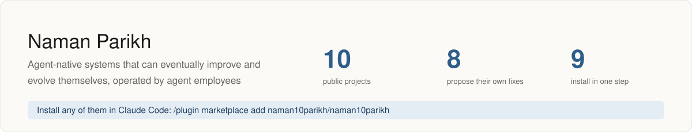
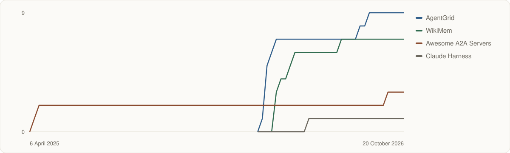

<!-- Generated by scripts/render.py from profile.json and projects.json, refreshed daily. Do not edit by hand. -->


# Hi, I'm Naman Parikh

**I build agent-native software: tools that agents use, built with agents, that improve themselves.**

Product manager at Microsoft, working on AI infrastructure. Computer Science, Duke University.

[](https://www.linkedin.com/in/naman-parikh1/) [](https://x.com/naman10parikh) [](https://drive.google.com/drive/folders/1_z-EHlN_dZcHGdrjUfwyVoWqvYpKRkjN?usp=sharing)

      

I believe the next era of AI will be defined not just by frontier model intelligence, but by the real economic value it creates. I measure it as **return on watts = tokens per watt × real value per token**, and my entire career has been about maximizing it.
Tokens per watt is what the hardware makes. Real value per token is what each token earns for the person who uses it.

## Start here

- **[Armory](https://github.com/naman10parikh/armory)**: Find and rank the parts of an agent's harness
- **[AgentGrid](https://github.com/naman10parikh/agentgrid)**: Run many coding agents at once
- **[WikiMem](https://github.com/naman10parikh/wikimem)**: Give your agents a memory
- **[AgentDial](https://github.com/naman10parikh/agentdial)**: Give an agent a phone number, an inbox and chat
- **[AgentBench](https://github.com/naman10parikh/agentbench)**: Score your agent setup out of 100
- **[Pixel](https://github.com/naman10parikh/pixel)**: Put frontend taste in CI
- **[Claude Harness](https://github.com/naman10parikh/claude-harness)**: Start from a complete Claude Code setup

## Recently shipped

<!-- releases:start -->

- [Hooksmith v0.1.0](https://github.com/naman10parikh/hooksmith/releases/tag/v0.1.0): 21 October 2026
- [AgentCast v0.1.0](https://github.com/naman10parikh/agentcast/releases/tag/v0.1.0): 21 October 2026
- [Plugsmith v0.1.0](https://github.com/naman10parikh/plugsmith/releases/tag/v0.1.0): 21 October 2026
- [Sandforge v0.2.0](https://github.com/naman10parikh/sandforge/releases/tag/v0.2.0): 21 October 2026
- [AgentDial v1.2.1](https://github.com/naman10parikh/agentdial/releases/tag/v1.2.1): 20 October 2026

<!-- releases:end -->

## Install any of them in one step

Every project with a plugin is an agent employee you can add to your coding agent. In Claude Code, add this one marketplace once, then install any of them by name:

```
/plugin marketplace add naman10parikh/naman10parikh
/plugin install <project>@naman10parikh
```

Each project's README also gives its MCP server, its Gemini CLI extension, its skills and its command line. Codex, Cursor, OpenCode and GitHub Copilot read each project's `AGENTS.md`.

## The projects

**40+ agent-native repositories**, counted on 20 October 2026:

| Where they are | Repositories |
| --- | --- |
| Open source now, listed below | 33 |
| Being prepared to open | 3 |
| Private: personal and company work | 10 |
| **In all** | **46** |

Agent-native means a file that tells agents how to work in the repository (`AGENTS.md` or `CLAUDE.md`) and at least one agent part: skills, sub-agents, hooks, an MCP server, a plugin or a self-improvement contract.

Each project below owns one part of an agent's harness, or of the product around an agent. 28 of them run their evals on a schedule and propose fixes for a person to review. The status matrix shows the rest.

### Harness components

| Project | Owns | What it does |
| --- | --- | --- |
| [AgentDial](https://github.com/naman10parikh/agentdial) | Identity | One identity for any agent across SMS, voice, email and chat apps. |
| [WikiMem](https://github.com/naman10parikh/wikimem) | Memory | Self-improving memory for agents: ingest anything, query everything. |
| [Skillsmith](https://github.com/naman10parikh/skillsmith) | Skills | Create, test and vet SKILL.md skills for any coding agent. |
| [Agent Booster](https://github.com/naman10parikh/agent-booster) | Tools / CLIs | Mechanical code edits without a model: deterministic, free, offline. |
| [Hooksmith](https://github.com/naman10parikh/hooksmith) | Hooks | Generate, lint and fire-test lifecycle hooks for coding agents. |
| [AgentCast](https://github.com/naman10parikh/agentcast) | Sub-agents | A library of reusable sub-agent personas, validated and scored. |
| [Plugsmith](https://github.com/naman10parikh/plugsmith) | Plugins | Turn any repository into a Claude Code plugin and marketplace. |
| [Armory](https://github.com/naman10parikh/armory) | MCPs and the component registry | Where agents gear up: 60,000+ open-source agent components, ranked on public evidence. |
| [AgentGrid](https://github.com/naman10parikh/agentgrid) | Dispatch | Spawn grids of coding agents (Claude, Codex, Gemini, Cursor) in one command. |
| [AgentSwarm](https://github.com/naman10parikh/agentswarm) | Dispatch | One YAML file, a swarm of expert agents, no idle panes. |
| [AgentBench](https://github.com/naman10parikh/agentbench) | Evals | Lighthouse for coding-agent harnesses: score your setup out of 100. |
| [AgentMoney](https://github.com/naman10parikh/agentmoney) | Observability | Know what your AI costs: pricing and spend for Claude, GPT and Gemini. |
| [Sandforge](https://github.com/naman10parikh/sandforge) | Sandbox / Infra | Sandbox templates with a trust envelope, validated and booted in E2B. |
| [Claude Harness](https://github.com/naman10parikh/claude-harness) | The whole harness, as a template | One command installs a tested Claude Code harness: skills, hooks, rules, sub-agents and memory. |

### App-shell employees

| Project | Owns | What it does |
| --- | --- | --- |
| [Pixel](https://github.com/naman10parikh/pixel) | Frontend | Frontend taste you can put in CI: it scaffolds Next.js 16 apps and blocks UI that looks AI-made. |
| [Pebble](https://github.com/naman10parikh/pebble) | Mobile | Ships React Native and Expo apps headlessly: shape call, scaffold, EAS build, OTA and store review. |
| [Turbo](https://github.com/naman10parikh/turbo) | Backend and runtime | Turns an OpenAPI spec into a strict TypeScript Hono service and audits it for production bugs. |
| [Acorn](https://github.com/naman10parikh/acorn) | Database | Designs Postgres schemas, makes migrations safe to run and tests row-level security so tenants stay apart. |
| [Badge](https://github.com/naman10parikh/badge) | Auth | Auth and agent identity, proven rather than assumed. |
| [Penny](https://github.com/naman10parikh/penny) | Payments | Payments and billing wired correctly, for products and their agents. |
| [Rocket](https://github.com/naman10parikh/rocket) | Deploy and CI | Release engineering you can put in CI. |

### Operations employees

| Project | Owns | What it does |
| --- | --- | --- |
| [Hush](https://github.com/naman10parikh/hush) | Secrets | Keeps secrets from reaching the model: blocked at the hook, scanned, and encrypted with SOPS and age. |
| [Canary](https://github.com/naman10parikh/canary) | Errors and uptime | Error and uptime monitoring on OpenTelemetry, with burn-rate alerts and proof the page gets delivered. |
| [Tally](https://github.com/naman10parikh/tally) | Analytics and feature flags | Product analytics, feature flags and A/B tests that fail closed, starting from a CI-gated tracking plan. |
| [Pigeon](https://github.com/naman10parikh/pigeon) | Transactional email | Transactional email that reaches the inbox: authenticated, kept apart from marketing mail, easy to unsubscribe. |
| [Bee](https://github.com/naman10parikh/bee) | Jobs, queues and webhooks | Background jobs and webhooks that are safe to run twice: every side effect happens once. |
| [Shelf](https://github.com/naman10parikh/shelf) | Storage and uploads | File uploads and object storage: presigned, validated, cheap to serve. |
| [Echo](https://github.com/naman10parikh/echo) | Rate limits and caching | Rate limits and caching for serverless APIs. |
| [Truffle](https://github.com/naman10parikh/truffle) | Search | Search you can measure: hybrid ranking with a relevance loop. |
| [Stamp](https://github.com/naman10parikh/stamp) | Compliance and SSO | SOC 2 readiness you can run: gap reports, audit trails and the SSO plan. |
| [Parrot](https://github.com/naman10parikh/parrot) | Localisation | Localisation for Next.js, checked in CI: plurals, right-to-left and search engines. |

### Tools

| Project | Owns | What it does |
| --- | --- | --- |
| [Svgforge](https://github.com/naman10parikh/svgforge) | Figures for agents | Diagrams as code: deterministic SVG figures with lint gates, drawn by agents. |
| [Fleet Audit](https://github.com/naman10parikh/fleet-audit) | Agent-native readiness | Scan your repositories for every surface coding agents need, and fix them. |

### Lists

| Project | Owns | What it does |
| --- | --- | --- |
| [Awesome A2A Servers](https://github.com/naman10parikh/awesome-a2a-servers) | Agent-to-agent servers | A curated list of Agent2Agent (A2A) protocol servers, clients, libraries and tutorials. |
| [Agent Entity Checklist](https://github.com/naman10parikh/agent-entity) | What an agent entity needs | Everything an agent entity needs, in 16 categories, each with a pick. |

<details><summary><b>Status matrix</b>: the 11 harness components and self-improvement, per project</summary>

| Project | Checks | Identity | Memory | Skills | Tools | Hooks | Sub-agents | MCPs | Dispatch | Evals | Observability | Sandbox | Self-improvement |
| --- | --- | --- | --- | --- | --- | --- | --- | --- | --- | --- | --- | --- | --- |
| [AgentDial](https://github.com/naman10parikh/agentdial) | ❌ failing | 🟡 | ✅ | ✅ | ✅ | ✅ | ✅ | ✅ | ✅ | ✅ | ✅ | ✅ | ✅ |
| [WikiMem](https://github.com/naman10parikh/wikimem) | ✅ passing | ✅ | ✅ | ✅ | ✅ | ✅ | ✅ | ✅ | ✅ | ✅ | ✅ | ✅ | ✅ |
| [Skillsmith](https://github.com/naman10parikh/skillsmith) | ✅ passing | ✅ | ✅ | ✅ | ✅ | ✅ | ✅ | ✅ | ✅ | ✅ | ✅ | ✅ | ✅ |
| [Agent Booster](https://github.com/naman10parikh/agent-booster) | ✅ passing | ✅ | ✅ | ✅ | ✅ | ✅ | ✅ | ✅ | ✅ | ✅ | ✅ | ✅ | ✅ |
| [Hooksmith](https://github.com/naman10parikh/hooksmith) | ✅ passing | ✅ | ✅ | ✅ | ✅ | ✅ | ✅ | ✅ | ✅ | ✅ | ✅ | ✅ | ✅ |
| [AgentCast](https://github.com/naman10parikh/agentcast) | ✅ passing | ✅ | ✅ | ✅ | ✅ | ✅ | ✅ | ✅ | ✅ | ✅ | ✅ | ✅ | ✅ |
| [Plugsmith](https://github.com/naman10parikh/plugsmith) | ✅ passing | ✅ | ✅ | ✅ | ✅ | ✅ | ✅ | ✅ | ✅ | ✅ | ✅ | ✅ | ✅ |
| [Armory](https://github.com/naman10parikh/armory) | ✅ passing | ✅ | ✅ | ✅ | ✅ | ✅ | ✅ | ✅ | ✅ | ✅ | ✅ | 🟡 | ✅ |
| [AgentGrid](https://github.com/naman10parikh/agentgrid) | ✅ passing | ✅ | ✅ | ✅ | ✅ | ✅ | ✅ | ✅ | ✅ | ✅ | ✅ | ✅ | ✅ |
| [AgentSwarm](https://github.com/naman10parikh/agentswarm) | ✅ passing | ✅ | ✅ | ✅ | ✅ | ✅ | ✅ | ✅ | ✅ | ✅ | ✅ | ✅ | ✅ |
| [AgentBench](https://github.com/naman10parikh/agentbench) | ✅ passing | ✅ | ✅ | ✅ | ✅ | ✅ | ✅ | ✅ | ✅ | ✅ | ✅ | ✅ | ✅ |
| [AgentMoney](https://github.com/naman10parikh/agentmoney) | ✅ passing | ✅ | ✅ | ✅ | ✅ | ✅ | ✅ | ✅ | ✅ | ✅ | ✅ | ✅ | ✅ |
| [Sandforge](https://github.com/naman10parikh/sandforge) | ✅ passing | ✅ | ✅ | ✅ | ✅ | ✅ | ✅ | ✅ | ✅ | ✅ | ✅ | ✅ | ✅ |
| [Claude Harness](https://github.com/naman10parikh/claude-harness) | ✅ passing | ✅ | ✅ | ✅ | ✅ | ✅ | ✅ | ✅ | ✅ | ✅ | ✅ | ✅ | ✅ |
| [Pixel](https://github.com/naman10parikh/pixel) | · | ✅ | ✅ | ✅ | ✅ | ✅ | ✅ | ✅ | ✅ | ✅ | ✅ | ✅ | ✅ |
| [Pebble](https://github.com/naman10parikh/pebble) | · | ✅ | ✅ | ✅ | ✅ | ✅ | ✅ | ✅ | ✅ | ✅ | ✅ | ✅ | ✅ |
| [Turbo](https://github.com/naman10parikh/turbo) | · | ✅ | ✅ | ✅ | ✅ | ✅ | ✅ | ✅ | ✅ | ✅ | ✅ | ✅ | 🟡 |
| [Acorn](https://github.com/naman10parikh/acorn) | · | ✅ | ✅ | ✅ | ✅ | ✅ | ✅ | ✅ | ✅ | ✅ | ✅ | ✅ | ✅ |
| [Badge](https://github.com/naman10parikh/badge) | · | ✅ | ✅ | ✅ | ✅ | ✅ | ✅ | ✅ | ✅ | ✅ | ✅ | ✅ | ✅ |
| [Penny](https://github.com/naman10parikh/penny) | · | ✅ | ✅ | ✅ | ✅ | ✅ | ✅ | ✅ | ✅ | ✅ | ✅ | ✅ | 🟡 |
| [Rocket](https://github.com/naman10parikh/rocket) | · | ✅ | ✅ | ✅ | ✅ | ✅ | ✅ | ✅ | ✅ | ✅ | ✅ | ✅ | ✅ |
| [Hush](https://github.com/naman10parikh/hush) | · | ✅ | ✅ | ✅ | ✅ | ✅ | ✅ | ✅ | ✅ | ✅ | ✅ | ✅ | ✅ |
| [Canary](https://github.com/naman10parikh/canary) | · | ✅ | ✅ | ✅ | ✅ | ✅ | ✅ | ✅ | ✅ | ✅ | ✅ | ✅ | ✅ |
| [Tally](https://github.com/naman10parikh/tally) | · | ✅ | ✅ | ✅ | ✅ | ✅ | ✅ | ✅ | ✅ | ✅ | ✅ | ✅ | 🟡 |
| [Pigeon](https://github.com/naman10parikh/pigeon) | · | ✅ | ✅ | ✅ | ✅ | ✅ | ✅ | ✅ | ✅ | ✅ | ✅ | ✅ | 🟡 |
| [Bee](https://github.com/naman10parikh/bee) | · | ✅ | ✅ | ✅ | ✅ | ✅ | ✅ | ✅ | ✅ | ✅ | ✅ | ✅ | ✅ |
| [Shelf](https://github.com/naman10parikh/shelf) | · | ✅ | ✅ | ✅ | ✅ | ✅ | ✅ | ✅ | ✅ | ✅ | ✅ | 🟡 | ✅ |
| [Echo](https://github.com/naman10parikh/echo) | · | ✅ | ✅ | ✅ | ✅ | ✅ | ✅ | ✅ | ✅ | ✅ | ✅ | ✅ | ✅ |
| [Truffle](https://github.com/naman10parikh/truffle) | · | ✅ | ✅ | ✅ | ✅ | ✅ | ✅ | ✅ | ✅ | ✅ | ✅ | ✅ | ✅ |
| [Stamp](https://github.com/naman10parikh/stamp) | · | ✅ | ✅ | ✅ | ✅ | ✅ | ✅ | ✅ | ✅ | ✅ | ✅ | ✅ | 🟡 |
| [Parrot](https://github.com/naman10parikh/parrot) | · | ✅ | ✅ | ✅ | ✅ | ✅ | ✅ | ✅ | ✅ | ✅ | ✅ | ✅ | ✅ |
| [Awesome A2A Servers](https://github.com/naman10parikh/awesome-a2a-servers) | · | · | · | · | · | · | · | · | ✅ | ✅ | · | · | 🟡 |
| [Svgforge](https://github.com/naman10parikh/svgforge) | · | ✅ | ✅ | ✅ | ✅ | ✅ | ✅ | ✅ | ✅ | ✅ | ✅ | ✅ | ✅ |
| [Fleet Audit](https://github.com/naman10parikh/fleet-audit) | · | ✅ | ✅ | ✅ | ✅ | ✅ | ✅ | ✅ | ✅ | ✅ | ✅ | ✅ | ✅ |
| [Agent Entity Checklist](https://github.com/naman10parikh/agent-entity) | · | ✅ | · | · | · | · | · | · | ✅ | ✅ | · | · | 🟡 |

Checks is the latest GitHub Actions result on each project's default branch, read daily. Each grade was set by running the project's own tests and evals; self-improvement is the level Darwin's checker verifies (✅ a weekly loop opens a proposal for a person, 🟡 evals gate every change). ✅ real and tested · 🟡 partial, with the reason in the project's README · · not graded yet

</details>

## Star history



## Now

- Building agent employees: agents with their own identity, skills and memory, which any coding agent can install, and which propose their own improvements for a person to review.
- Measuring every system by return on watts: how many tokens a watt makes, and how much real value each token carries.
- Open-sourcing the parts as I go, each one an agent employee you can install in one step.

## Contributions

- Thanked in the official Model Context Protocol TypeScript SDK for an earlier pull request on the same fix ([#1736](https://github.com/modelcontextprotocol/typescript-sdk/pull/1736), consolidated into [#1766](https://github.com/modelcontextprotocol/typescript-sdk/pull/1766), merged 30 March 2026).

<details><summary>How this page works</summary>

This page is generated from `profile.json` and `projects.json` by `scripts/render.py`. A GitHub Action runs it every day: it refreshes the star counts, releases, check results and star chart from GitHub's own API, so no outside image service can break the page. Agents can read [`llms.txt`](llms.txt) and [`AGENTS.md`](AGENTS.md) to choose and install a project.

</details>
